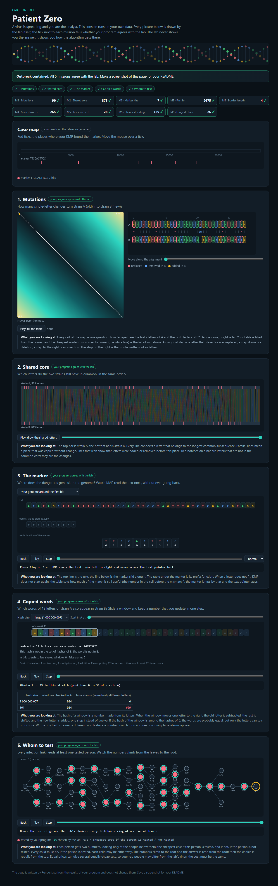

# Assignment 4. Patient Zero

Student ID: 254826
Name: Akylbek Madiyar
Group: SE-2532

This file is the report. The task: `docs/Assignment4.pdf`.

## Program output

The 9 lines my program prints on my data (`java -cp out Main`):

    Mutations: 90
    Shared core: 875
    Marker hits: 7
    First hit: 2075
    Border length: 4
    Shared words: 265
    Tests needed: 28
    Cheapest testing: 139
    Longest chain: 26

All 9 lines have a green tick in the lab console. My outbreak report (a screenshot of `output/outbreak.html`):

## Questions

**Mission 1. What does the cell d[i][j] of your table mean, and how is it computed from other cells?**

d[i][j] is the smallest number of changes (replace, insert, delete) needed to turn the first i letters of A into the first j letters of B. The first column is d[i][0] = i (delete everything) and the first row is d[0][j] = j (insert everything). Every other cell is the minimum of three options: the diagonal cell d[i-1][j-1] plus 0 if the last letters are equal or plus 1 if they are not (replace), the cell above d[i-1][j] plus 1 (delete), and the cell on the left d[i][j-1] plus 1 (insert). The answer is the bottom right cell d[n][m].

**Mission 2. How is the longest common subsequence different from the longest common substring? My Shared core is bigger than the number of letters that are the same at the same place: why?**

A substring must be a continuous piece of the word, but a subsequence keeps the order of letters and may skip letters between them. So the LCS can be much longer than the longest common substring. My Shared core (875) is bigger than the number of equal letters at equal positions because the new strain has insertions and deletions. They shift everything after them by one place, so a letter-by-letter comparison sees mismatches, but the LCS jumps over the inserted letters and still matches the letters in the same order.

**Mission 3. What does the prefix function tell you, and why does the pointer in the text never go back in KMP? What is the Border length of my marker and what does it mean?**

pi[i] is the length of the longest proper prefix of marker[0..i] that is also a suffix of it, so it tells how much of the already matched part can be kept after a mismatch. In KMP, after a mismatch I do not move the text pointer back, I only move the marker pointer k to pi[k-1]: the last pi[k-1] letters of the text already equal the beginning of the marker, so they do not need to be checked again. The pointer of the text only grows, and k can go down only as many times as it went up, so the search is O(n + m). My marker is `TTCCACTTCC` and its Border length is 4: the beginning `TTCC` is the same as the ending `TTCC`. It means that two occurrences of my marker in the genome can overlap by up to 4 letters, and after a full match KMP continues from k = 4 and not from 0.

**Mission 4. Why must you compare the letters after the hashes are equal? What happens to the cost of Rabin-Karp if many windows have the same hash?**

Hashes are taken modulo a number, so two different words can get the same hash (a collision). Equal hashes only say that the words are possibly equal, so I compare the letters to be sure, otherwise the answer would be wrong and would depend on MOD. If many windows have the same hash, I must compare letters many times, each comparison costs k operations, and the time goes from about O(n + m) in the average case towards O(n * m * k) in the worst case, like the naive search.

**Mission 5. What are the two states of a person in your DP, and how do you get the answer for a person from its children? Why does a greedy "test the person with most links first" not always give the cheapest answer?**

For every person v I keep two numbers for his subtree: yes[v], the cheapest cost when v is tested, and no[v], the cheapest cost when v is not tested. If v is tested, the links to his children are already covered, so every child takes the cheaper of its two states: yes[v] = cost[v] + sum of min(yes[c], no[c]). If v is not tested, every child must be tested to cover the link: no[v] = sum of yes[c]. The answer is min(yes[0], no[0]) at the root, and then I walk down from the root with the same rule to see who is tested. Greedy looks only at the number of links and ignores the costs and the rest of the tree. For example, in a star where the centre costs 100 and three leaves cost 1 each, greedy tests the centre for 100, but the cheapest answer is to test the three leaves for 3.

## AI use

I used Claude (Anthropic) as a helper. First it read the task and the syllabus and explained the whole assignment to me: what is asked, what every file in the starter project does, and what I must do in each mission. Then for every mission it explained the idea step by step (what the table or function means, the formula, the usual traps) and showed a hand example on a small case. After that it gave me the code for the methods and explained it line by line, and I typed it into the project, ran `java tools/Check.java` and my own data, and checked the lab console. It also helped me read the output of `Check` and of `Bench` and explained the timing numbers. I wrote the answers in this README myself after studying the explanations. I did not take code or text from books or websites.

## Timing (Mission 7)

Milliseconds, average of 3 runs, from `java -cp out Bench`.

| test | size | time |
|---|---|---|
| naive search | 20 000 / 40 000 / 80 000 | 114.8 / 189.6 / 383.3 ms |
| KMP | 20 000 / 40 000 / 80 000 | 3.9 / 2.7 / 0.8 ms |
| edit distance | 500 / 1000 / 2000 / 4000 | 20.8 / 13.3 / 58.6 / 152.5 ms |

The naive search grows about two times when the text becomes two times longer (114.8, 189.6, 383.3 ms), and it is slow because for a pattern of length 2000 it compares many letters again at every position. KMP stays at a few milliseconds, because its time is O(n + m) and the text pointer never goes back. The edit distance grows about four times when the length doubles (58.6 ms for 2000 and 152.5 ms for 4000, and from 1000 to 4000 it is about 11 times), which agrees with O(n * m). The smallest values (KMP at 20 000, edit distance at 500) are higher than expected, I think because Java is still warming up (JIT) in the first runs.

## Complexity

n is the length of the text (or of a strain), m the length of the pattern, k the length of the window, v the number of people.

| algorithm | time | space | assumptions |
|---|---|---|---|
| Edit distance | O(n * m) | O(n * m) | full table (n+1) x (m+1), every cell is computed in O(1) from three neighbours |
| LCS | O(n * m) | O(n * m) | the same table, every cell in O(1) |
| Prefix function and KMP | O(n + m) | O(m) | the marker pointer goes down at most as many times as it went up, the text pointer never goes back |
| Rabin-Karp (shared words) | O(n + m) on average, O(n * m * k) in the worst case | O(n + m) | the hash of the next window is computed in O(1); the worst case is when many different windows have the same hash and letters are compared every time |
| Tree DP | O(v) | O(v) | every person and every link is visited a constant number of times (BFS order, then two passes) |